# Caboodle Simulation Data Model

**Status:** Proposed for review; not approved for implementation. This models synthetic analytical data, not proprietary Epic schemas. Definitions follow the Caboodle dictionary in `plan.md`; all eight dimensions and seven facts belong to `dbo` in the separate Caboodle simulation database.

## Reading the Diagrams

The overview shows the complete fact-to-dimension relationships without columns. The detailed model expands all table-specific, audit, origin, history, and shared fact columns.

`PK` means primary key, `FK` means foreign key, and `UK` means a single-column unique key. All columns are `NOT NULL` unless their comment begins with `NULL`. Decimal precision and scale are shown in comments. Timestamps are UTC; date keys use `YYYYMMDD`.

Relationship labels name the fact's FK column. `||` means exactly one, `o|` / `|o` means zero or one, and `o{` means zero or more. Dashed connectors are non-identifying relationships, not optional relationships; fact PKs are independent of dimension keys.

Source IDs are lineage identifiers, not cross-database FKs or fact-to-fact relationships. `DimCoverage.SourcePatientID` does not reference a versioned `DimPatient` row. Business-key uniqueness is composite where documented below; it does not make individual source IDs or code columns globally unique.

## Relationship Overview

```mermaid
erDiagram
    DimPatient ||..o{ FactEncounter : PatientKey
    DimDepartment ||..o{ FactEncounter : DepartmentKey
    DimProvider |o..o{ FactEncounter : AttendingProviderKey
    DimCoverage |o..o{ FactEncounter : CoverageKey
    DimDate ||..o{ FactEncounter : ArrivalDateKey
    DimDate |o..o{ FactEncounter : DischargeDateKey

    DimPatient ||..o{ FactDiagnosis : PatientKey
    DimDepartment ||..o{ FactDiagnosis : DepartmentKey
    DimProvider |o..o{ FactDiagnosis : DiagnosingProviderKey
    DimDiagnosis ||..o{ FactDiagnosis : DiagnosisKey
    DimDate ||..o{ FactDiagnosis : DiagnosisDateKey

    DimPatient ||..o{ FactProcedure : PatientKey
    DimDepartment ||..o{ FactProcedure : DepartmentKey
    DimProvider |o..o{ FactProcedure : PerformingProviderKey
    DimProcedure ||..o{ FactProcedure : ProcedureKey
    DimDate ||..o{ FactProcedure : OrderedDateKey
    DimDate |o..o{ FactProcedure : PerformedDateKey

    DimPatient ||..o{ FactMedicationOrder : PatientKey
    DimDepartment ||..o{ FactMedicationOrder : DepartmentKey
    DimProvider ||..o{ FactMedicationOrder : OrderingProviderKey
    DimMedication ||..o{ FactMedicationOrder : MedicationKey
    DimDate ||..o{ FactMedicationOrder : OrderedDateKey

    DimPatient ||..o{ FactMedicationAdministration : PatientKey
    DimDepartment ||..o{ FactMedicationAdministration : DepartmentKey
    DimProvider |o..o{ FactMedicationAdministration : AdministeringProviderKey
    DimMedication ||..o{ FactMedicationAdministration : MedicationKey
    DimDate |o..o{ FactMedicationAdministration : AdministrationDateKey
    DimDate ||..o{ FactMedicationAdministration : RecordedDateKey

    DimPatient ||..o{ FactLabResult : PatientKey
    DimDepartment ||..o{ FactLabResult : DepartmentKey
    DimProvider ||..o{ FactLabResult : OrderingProviderKey
    DimDate ||..o{ FactLabResult : OrderedDateKey
    DimDate |o..o{ FactLabResult : ResultDateKey

    DimPatient ||..o{ FactAppointment : PatientKey
    DimDepartment ||..o{ FactAppointment : DepartmentKey
    DimProvider |o..o{ FactAppointment : ProviderKey
    DimDate ||..o{ FactAppointment : ScheduledDateKey
```

## Detailed Table Model

```mermaid
erDiagram
    DimPatient {
        bigint PatientKey PK "One historical patient version"
        bigint SourcePatientID "Clarity patient lineage; not globally unique across versions"
        varchar(30) MedicalRecordNumber
        nvarchar(100) FirstName
        nvarchar(100) LastName
        date BirthDate
        varchar(20) AdministrativeSexCode
        nvarchar(100) City "NULL"
        varchar(10) StateCode "NULL"
        varchar(20) PostalCode "NULL"
        date DeathDate "NULL"
        varchar(20) PatientStatus
        datetime2(7) EffectiveFromUtc "Inclusive version start"
        datetime2(7) EffectiveToUtc "NULL; exclusive version end"
        bit IsCurrent
        varchar(30) OriginSystem
        datetime2(7) OriginModifiedAtUtc "Source lineage timestamp"
        bit IsDeleted
        datetime2(7) EtlCreatedAtUtc
        datetime2(7) EtlModifiedAtUtc "Caboodle extraction watermark"
        uniqueidentifier EtlBatchID
    }

    DimProvider {
        bigint ProviderKey PK "One historical provider version"
        bigint SourceProviderID
        varchar(30) ProviderCode
        nvarchar(200) DisplayName
        varchar(30) ProviderTypeCode
        varchar(30) SpecialtyCode "NULL"
        bit IsActive
        datetime2(7) EffectiveFromUtc "Inclusive version start"
        datetime2(7) EffectiveToUtc "NULL; exclusive version end"
        bit IsCurrent
        varchar(30) OriginSystem
        datetime2(7) OriginModifiedAtUtc "Source lineage timestamp"
        bit IsDeleted
        datetime2(7) EtlCreatedAtUtc
        datetime2(7) EtlModifiedAtUtc "Caboodle extraction watermark"
        uniqueidentifier EtlBatchID
    }

    DimDepartment {
        bigint DepartmentKey PK "One historical department version"
        bigint SourceDepartmentID
        varchar(30) DepartmentCode
        nvarchar(150) DepartmentName
        varchar(30) FacilityCode
        varchar(30) DepartmentTypeCode
        bit IsActive
        datetime2(7) EffectiveFromUtc "Inclusive version start"
        datetime2(7) EffectiveToUtc "NULL; exclusive version end"
        bit IsCurrent
        varchar(30) OriginSystem
        datetime2(7) OriginModifiedAtUtc "Source lineage timestamp"
        bit IsDeleted
        datetime2(7) EtlCreatedAtUtc
        datetime2(7) EtlModifiedAtUtc "Caboodle extraction watermark"
        uniqueidentifier EtlBatchID
    }

    DimDate {
        int DateKey PK "YYYYMMDD"
        date CalendarDate UK
        smallint CalendarYear
        tinyint CalendarQuarter
        tinyint MonthNumber
        nvarchar(10) MonthName
        tinyint DayOfMonth
        tinyint IsoDayOfWeek "Monday 1 through Sunday 7"
        bit IsWeekend
        datetime2(7) EtlCreatedAtUtc
        datetime2(7) EtlModifiedAtUtc "Caboodle extraction watermark"
        uniqueidentifier EtlBatchID
    }

    DimDiagnosis {
        bigint DiagnosisKey PK "One diagnosis code per origin and code system"
        varchar(30) DiagnosisCodeSystem
        varchar(30) DiagnosisCode
        nvarchar(250) DiagnosisDescription
        varchar(30) OriginSystem
        datetime2(7) OriginModifiedAtUtc "Source lineage timestamp"
        bit IsDeleted
        datetime2(7) EtlCreatedAtUtc
        datetime2(7) EtlModifiedAtUtc "Caboodle extraction watermark"
        uniqueidentifier EtlBatchID
    }

    DimProcedure {
        bigint ProcedureKey PK "One procedure code per origin and code system"
        varchar(30) ProcedureCodeSystem
        varchar(30) ProcedureCode
        nvarchar(250) ProcedureDescription
        varchar(30) OriginSystem
        datetime2(7) OriginModifiedAtUtc "Source lineage timestamp"
        bit IsDeleted
        datetime2(7) EtlCreatedAtUtc
        datetime2(7) EtlModifiedAtUtc "Caboodle extraction watermark"
        uniqueidentifier EtlBatchID
    }

    DimMedication {
        bigint MedicationKey PK "One medication product per origin and code system"
        varchar(30) MedicationCodeSystem
        varchar(50) MedicationCode
        nvarchar(200) MedicationName
        varchar(30) OriginSystem
        datetime2(7) OriginModifiedAtUtc "Source lineage timestamp"
        bit IsDeleted
        datetime2(7) EtlCreatedAtUtc
        datetime2(7) EtlModifiedAtUtc "Caboodle extraction watermark"
        uniqueidentifier EtlBatchID
    }

    DimCoverage {
        bigint CoverageKey PK "One historical enrollment version"
        bigint SourceCoverageID
        bigint SourcePatientID "Lineage only; not a DimPatient FK"
        varchar(40) CoverageNumber
        varchar(30) PayerCode
        nvarchar(150) PayerName
        varchar(40) PlanCode
        nvarchar(150) PlanName
        varchar(30) CoverageTypeCode
        date EffectiveDate "Coverage period start"
        date TerminationDate "NULL; inclusive coverage period end"
        varchar(20) CoverageStatus
        datetime2(7) EffectiveFromUtc "Inclusive version start"
        datetime2(7) EffectiveToUtc "NULL; exclusive version end"
        bit IsCurrent
        varchar(30) OriginSystem
        datetime2(7) OriginModifiedAtUtc "Source lineage timestamp"
        bit IsDeleted
        datetime2(7) EtlCreatedAtUtc
        datetime2(7) EtlModifiedAtUtc "Caboodle extraction watermark"
        uniqueidentifier EtlBatchID
    }

    FactEncounter {
        bigint EncounterKey PK "One encounter; accumulating snapshot"
        bigint SourceEncounterID "Origin-scoped event identity; not a fact FK"
        varchar(40) EncounterNumber
        bigint PatientKey FK
        bigint DepartmentKey FK
        bigint AttendingProviderKey FK "NULL"
        bigint CoverageKey FK "NULL; explicitly assigned primary enrollment"
        int ArrivalDateKey FK
        int DischargeDateKey FK "NULL"
        datetime2(7) ArrivalAtUtc
        datetime2(7) DischargeAtUtc "NULL"
        varchar(30) EncounterTypeCode
        varchar(20) EncounterStatus
        varchar(30) DischargeDispositionCode "NULL"
        decimal LengthOfStayMinutes "NULL; SQL decimal(18,2)"
        int EncounterCount "One per encounter before status and deletion filters"
        varchar(30) OriginSystem
        datetime2(7) OriginModifiedAtUtc "Source lineage timestamp"
        bit IsDeleted
        datetime2(7) EtlCreatedAtUtc
        datetime2(7) EtlModifiedAtUtc "Caboodle extraction watermark"
        uniqueidentifier EtlBatchID
    }

    FactDiagnosis {
        bigint DiagnosisFactKey PK "One diagnosis assignment"
        bigint SourceDiagnosisID "Origin-scoped event identity"
        bigint SourceEncounterID "Lineage only; not a fact FK"
        bigint PatientKey FK
        bigint DepartmentKey FK
        bigint DiagnosisKey FK
        bigint DiagnosingProviderKey FK "NULL"
        int DiagnosisDateKey FK
        datetime2(7) DiagnosedAtUtc
        smallint DiagnosisSequence
        bit IsPrimary
        varchar(20) DiagnosisStatus
        int DiagnosisCount "One per assignment"
        varchar(30) OriginSystem
        datetime2(7) OriginModifiedAtUtc "Source lineage timestamp"
        bit IsDeleted
        datetime2(7) EtlCreatedAtUtc
        datetime2(7) EtlModifiedAtUtc "Caboodle extraction watermark"
        uniqueidentifier EtlBatchID
    }

    FactProcedure {
        bigint ProcedureFactKey PK "One procedure event including unperformed orders"
        bigint SourceProcedureID "Origin-scoped event identity"
        bigint SourceEncounterID "Lineage only; not a fact FK"
        bigint PatientKey FK
        bigint DepartmentKey FK
        bigint ProcedureKey FK
        bigint PerformingProviderKey FK "NULL"
        int OrderedDateKey FK
        int PerformedDateKey FK "NULL"
        datetime2(7) OrderedAtUtc
        datetime2(7) PerformedAtUtc "NULL"
        varchar(20) ProcedureStatus
        int ProcedureCount "One per procedure event"
        varchar(30) OriginSystem
        datetime2(7) OriginModifiedAtUtc "Source lineage timestamp"
        bit IsDeleted
        datetime2(7) EtlCreatedAtUtc
        datetime2(7) EtlModifiedAtUtc "Caboodle extraction watermark"
        uniqueidentifier EtlBatchID
    }

    FactMedicationOrder {
        bigint MedicationOrderKey PK "One medication order"
        bigint SourceMedicationOrderID "Origin-scoped event identity"
        bigint SourceEncounterID "Lineage only; not a fact FK"
        bigint PatientKey FK
        bigint DepartmentKey FK
        bigint MedicationKey FK
        bigint OrderingProviderKey FK
        int OrderedDateKey FK
        datetime2(7) OrderedAtUtc
        datetime2(7) StartAtUtc "NULL"
        datetime2(7) EndAtUtc "NULL"
        decimal OrderedDose "NULL; SQL decimal(18,4)"
        varchar(30) DoseUnit "NULL"
        varchar(30) RouteCode "NULL"
        varchar(30) FrequencyCode "NULL"
        varchar(20) OrderStatus
        int OrderCount "One per order"
        varchar(30) OriginSystem
        datetime2(7) OriginModifiedAtUtc "Source lineage timestamp"
        bit IsDeleted
        datetime2(7) EtlCreatedAtUtc
        datetime2(7) EtlModifiedAtUtc "Caboodle extraction watermark"
        uniqueidentifier EtlBatchID
    }

    FactMedicationAdministration {
        bigint MedicationAdministrationKey PK "One administration or non-administration event"
        bigint SourceMedicationAdministrationID "Origin-scoped event identity"
        bigint SourceEncounterID "Lineage only; not a fact FK"
        bigint SourceMedicationOrderID "Lineage only; not a fact FK"
        bigint PatientKey FK
        bigint DepartmentKey FK
        bigint MedicationKey FK
        bigint AdministeringProviderKey FK "NULL"
        int AdministrationDateKey FK "NULL; actual administration date"
        int RecordedDateKey FK
        datetime2(7) ScheduledAtUtc "NULL"
        datetime2(7) RecordedAtUtc
        datetime2(7) AdministeredAtUtc "NULL"
        decimal AdministeredDose "NULL; SQL decimal(18,4)"
        varchar(30) DoseUnit "NULL"
        varchar(20) AdministrationStatus
        int AdministrationEventCount "One per documented event; not necessarily a dose given"
        varchar(30) OriginSystem
        datetime2(7) OriginModifiedAtUtc "Source lineage timestamp"
        bit IsDeleted
        datetime2(7) EtlCreatedAtUtc
        datetime2(7) EtlModifiedAtUtc "Caboodle extraction watermark"
        uniqueidentifier EtlBatchID
    }

    FactLabResult {
        bigint LabResultKey PK "One laboratory result component including pending results"
        bigint SourceLaboratoryResultID "Origin-scoped event identity"
        bigint SourceEncounterID "Lineage only; not a fact FK"
        bigint SourceLaboratoryOrderID "Lineage only; not a fact FK"
        bigint PatientKey FK
        bigint DepartmentKey FK
        bigint OrderingProviderKey FK
        int OrderedDateKey FK
        int ResultDateKey FK "NULL"
        datetime2(7) OrderedAtUtc
        datetime2(7) ResultedAtUtc "NULL"
        varchar(40) TestCode
        varchar(40) ComponentCode
        nvarchar(200) ComponentName
        decimal NumericValue "NULL; SQL decimal(18,6); not additive"
        nvarchar(1000) TextValue "NULL"
        varchar(30) ResultUnit "NULL"
        decimal ReferenceLow "NULL; SQL decimal(18,6)"
        decimal ReferenceHigh "NULL; SQL decimal(18,6)"
        varchar(20) AbnormalFlag "NULL"
        varchar(20) ResultStatus
        int ResultCount "One per result component"
        varchar(30) OriginSystem
        datetime2(7) OriginModifiedAtUtc "Source lineage timestamp"
        bit IsDeleted
        datetime2(7) EtlCreatedAtUtc
        datetime2(7) EtlModifiedAtUtc "Caboodle extraction watermark"
        uniqueidentifier EtlBatchID
    }

    FactAppointment {
        bigint AppointmentKey PK "One appointment including canceled visits and no-shows"
        bigint SourceAppointmentID "Origin-scoped event identity"
        bigint SourceEncounterID "NULL; linked encounter lineage only"
        varchar(40) AppointmentNumber
        bigint PatientKey FK
        bigint DepartmentKey FK
        bigint ProviderKey FK "NULL"
        int ScheduledDateKey FK
        datetime2(7) ScheduledStartAtUtc
        datetime2(7) ScheduledEndAtUtc
        varchar(30) AppointmentTypeCode
        varchar(20) AppointmentStatus
        datetime2(7) CanceledAtUtc "NULL"
        decimal ScheduledDurationMinutes "SQL decimal(18,2)"
        int AppointmentCount "One per appointment"
        varchar(30) OriginSystem
        datetime2(7) OriginModifiedAtUtc "Source lineage timestamp"
        bit IsDeleted
        datetime2(7) EtlCreatedAtUtc
        datetime2(7) EtlModifiedAtUtc "Caboodle extraction watermark"
        uniqueidentifier EtlBatchID
    }

    DimPatient ||..o{ FactEncounter : PatientKey
    DimDepartment ||..o{ FactEncounter : DepartmentKey
    DimProvider |o..o{ FactEncounter : AttendingProviderKey
    DimCoverage |o..o{ FactEncounter : CoverageKey
    DimDate ||..o{ FactEncounter : ArrivalDateKey
    DimDate |o..o{ FactEncounter : DischargeDateKey

    DimPatient ||..o{ FactDiagnosis : PatientKey
    DimDepartment ||..o{ FactDiagnosis : DepartmentKey
    DimProvider |o..o{ FactDiagnosis : DiagnosingProviderKey
    DimDiagnosis ||..o{ FactDiagnosis : DiagnosisKey
    DimDate ||..o{ FactDiagnosis : DiagnosisDateKey

    DimPatient ||..o{ FactProcedure : PatientKey
    DimDepartment ||..o{ FactProcedure : DepartmentKey
    DimProvider |o..o{ FactProcedure : PerformingProviderKey
    DimProcedure ||..o{ FactProcedure : ProcedureKey
    DimDate ||..o{ FactProcedure : OrderedDateKey
    DimDate |o..o{ FactProcedure : PerformedDateKey

    DimPatient ||..o{ FactMedicationOrder : PatientKey
    DimDepartment ||..o{ FactMedicationOrder : DepartmentKey
    DimProvider ||..o{ FactMedicationOrder : OrderingProviderKey
    DimMedication ||..o{ FactMedicationOrder : MedicationKey
    DimDate ||..o{ FactMedicationOrder : OrderedDateKey

    DimPatient ||..o{ FactMedicationAdministration : PatientKey
    DimDepartment ||..o{ FactMedicationAdministration : DepartmentKey
    DimProvider |o..o{ FactMedicationAdministration : AdministeringProviderKey
    DimMedication ||..o{ FactMedicationAdministration : MedicationKey
    DimDate |o..o{ FactMedicationAdministration : AdministrationDateKey
    DimDate ||..o{ FactMedicationAdministration : RecordedDateKey

    DimPatient ||..o{ FactLabResult : PatientKey
    DimDepartment ||..o{ FactLabResult : DepartmentKey
    DimProvider ||..o{ FactLabResult : OrderingProviderKey
    DimDate ||..o{ FactLabResult : OrderedDateKey
    DimDate |o..o{ FactLabResult : ResultDateKey

    DimPatient ||..o{ FactAppointment : PatientKey
    DimDepartment ||..o{ FactAppointment : DepartmentKey
    DimProvider |o..o{ FactAppointment : ProviderKey
    DimDate ||..o{ FactAppointment : ScheduledDateKey
```

## Fact Grain and Historical Lookup

| Fact | Grain | Type 2 Dimension Lookup Time |
| --- | --- | --- |
| `FactEncounter` | One encounter, updated through its lifecycle | `ArrivalAtUtc` |
| `FactDiagnosis` | One diagnosis assignment | `DiagnosedAtUtc` |
| `FactProcedure` | One procedure event | `PerformedAtUtc`, otherwise `OrderedAtUtc` |
| `FactMedicationOrder` | One medication order | `OrderedAtUtc` |
| `FactMedicationAdministration` | One administration or non-administration record | `AdministeredAtUtc`, otherwise `RecordedAtUtc` |
| `FactLabResult` | One result component, including pending components | `ResultedAtUtc`, otherwise parent order `OrderedAtUtc` |
| `FactAppointment` | One scheduled appointment, even without an encounter | `ScheduledStartAtUtc` |

## Constraints Beyond the Diagram

- `DimPatient`, `DimProvider`, `DimDepartment`, and `DimCoverage` use Type 2 history. Match origin, source identity, and event time within `[EffectiveFromUtc, EffectiveToUtc)`; require non-overlapping intervals and one current version per origin/source identity.
- `DimDiagnosis`, `DimProcedure`, and `DimMedication` use Type 1 label corrections. Their unique business keys are `(OriginSystem, CodeSystem, Code)` using the respective diagnosis, procedure, or medication columns. `DimDate` is a static calendar with only the common ETL audit columns.
- Each fact has a composite unique key combining `OriginSystem` and its source event ID: `SourceEncounterID`, `SourceDiagnosisID`, `SourceProcedureID`, `SourceMedicationOrderID`, `SourceMedicationAdministrationID`, `SourceLaboratoryResultID`, or `SourceAppointmentID`, respectively.
- Multiple date-key relationships represent different roles of the same physical `DimDate`, not additional date tables.
- `FactEncounter.CoverageKey` comes only from the source encounter's explicit primary coverage assignment. Validate the patient, coverage period, and dimension validity; do not join all patient enrollments to encounter facts.
- A null provider means genuinely unassigned. Unresolved non-null source references are quarantined for replay, not silently converted to null.
- Preserve `IsDeleted` history and refresh `EtlModifiedAtUtc` for SCD expirations, corrections, delete propagation, and dependent changes. `OriginModifiedAtUtc` is lineage, not the extraction watermark.
- Clarity `VitalSign` has no initial Caboodle fact; `LaboratoryOrder` contributes to `FactLabResult` but has no standalone fact. Both remain in the Clarity-to-Bronze ingestion scope.
