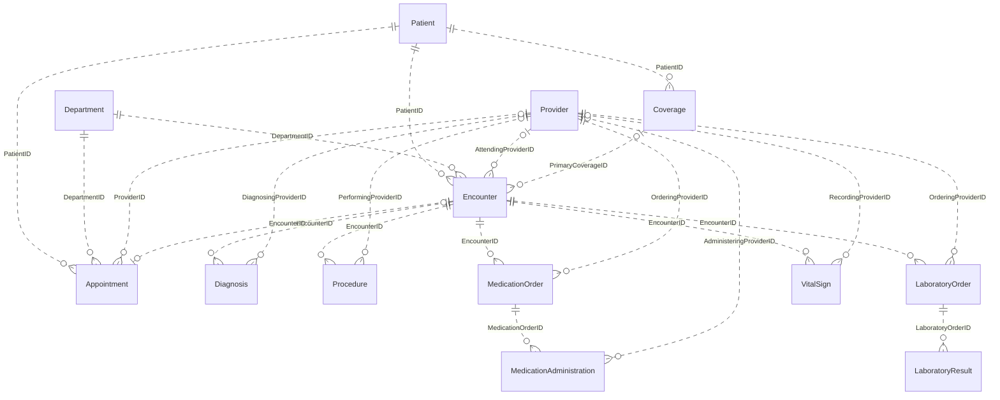

# Clarity Simulation Data Model

**Status:** Proposed for review; not approved for implementation. This models synthetic operational data, not proprietary Epic schemas. Definitions follow the Clarity dictionary in `plan.md`; all 13 tables belong to `dbo` in the Clarity simulation database.

## Reading the Diagrams

The overview shows relationships without column detail. The detailed model includes every table-specific column and the four shared audit columns on every table.

`PK` means primary key, `FK` means foreign key, and `UK` means a single-column unique key. All columns are `NOT NULL` unless their comment begins with `NULL`. Decimal precision and scale are shown in comments. Timestamps are UTC.

Relationship labels name the child's FK column. `||` means exactly one, `o|` / `|o` means zero or one, and `o{` means zero or more. Dashed connectors are non-identifying relationships: each child has its own independent primary key. Optionality comes from the endpoint symbols, not the dashed line.

## Relationship Overview

## Detailed Table Model

```mermaid
erDiagram
    Patient {
        bigint PatientID PK
        varchar(30) MedicalRecordNumber UK "Synthetic patient business identifier"
        nvarchar(100) FirstName
        nvarchar(100) LastName
        date BirthDate
        varchar(20) AdministrativeSexCode
        nvarchar(100) City "NULL"
        varchar(10) StateCode "NULL"
        varchar(20) PostalCode "NULL"
        date DeathDate "NULL"
        varchar(20) PatientStatus
        datetime2(7) CreatedAtUtc
        datetime2(7) ModifiedAtUtc "Incremental watermark"
        bit IsDeleted
        datetime2(7) DeletedAtUtc "NULL; soft-delete time"
    }

    Provider {
        bigint ProviderID PK
        varchar(30) ProviderCode UK
        nvarchar(200) DisplayName
        varchar(30) ProviderTypeCode
        varchar(30) SpecialtyCode "NULL"
        bit IsActive
        datetime2(7) CreatedAtUtc
        datetime2(7) ModifiedAtUtc "Incremental watermark"
        bit IsDeleted
        datetime2(7) DeletedAtUtc "NULL; soft-delete time"
    }

    Department {
        bigint DepartmentID PK
        varchar(30) DepartmentCode UK
        nvarchar(150) DepartmentName
        varchar(30) FacilityCode
        varchar(30) DepartmentTypeCode
        bit IsActive
        datetime2(7) CreatedAtUtc
        datetime2(7) ModifiedAtUtc "Incremental watermark"
        bit IsDeleted
        datetime2(7) DeletedAtUtc "NULL; soft-delete time"
    }

    Encounter {
        bigint EncounterID PK
        varchar(40) EncounterNumber UK
        bigint PatientID FK
        bigint DepartmentID FK
        bigint AttendingProviderID FK "NULL"
        bigint PrimaryCoverageID FK "NULL; explicitly assigned enrollment"
        varchar(30) EncounterTypeCode
        varchar(20) EncounterStatus
        datetime2(7) ArrivalAtUtc
        datetime2(7) DischargeAtUtc "NULL; open encounter"
        varchar(30) DischargeDispositionCode "NULL"
        datetime2(7) CreatedAtUtc
        datetime2(7) ModifiedAtUtc "Incremental watermark"
        bit IsDeleted
        datetime2(7) DeletedAtUtc "NULL; soft-delete time"
    }

    Diagnosis {
        bigint DiagnosisID PK "One diagnosis assignment"
        bigint EncounterID FK
        bigint DiagnosingProviderID FK "NULL"
        varchar(30) DiagnosisCodeSystem
        varchar(30) DiagnosisCode
        nvarchar(250) DiagnosisDescription
        smallint DiagnosisSequence "Part of encounter-sequence composite unique key"
        bit IsPrimary
        datetime2(7) DiagnosedAtUtc
        varchar(20) DiagnosisStatus
        datetime2(7) CreatedAtUtc
        datetime2(7) ModifiedAtUtc "Incremental watermark"
        bit IsDeleted
        datetime2(7) DeletedAtUtc "NULL; soft-delete time"
    }

    Procedure {
        bigint ProcedureID PK "One procedure event"
        bigint EncounterID FK
        bigint PerformingProviderID FK "NULL"
        varchar(30) ProcedureCodeSystem
        varchar(30) ProcedureCode
        nvarchar(250) ProcedureDescription
        datetime2(7) OrderedAtUtc
        datetime2(7) PerformedAtUtc "NULL; not yet performed"
        varchar(20) ProcedureStatus
        datetime2(7) CreatedAtUtc
        datetime2(7) ModifiedAtUtc "Incremental watermark"
        bit IsDeleted
        datetime2(7) DeletedAtUtc "NULL; soft-delete time"
    }

    MedicationOrder {
        bigint MedicationOrderID PK
        bigint EncounterID FK
        bigint OrderingProviderID FK
        varchar(30) MedicationCodeSystem
        varchar(50) MedicationCode
        nvarchar(200) MedicationName
        decimal OrderedDose "NULL; SQL decimal(18,4)"
        varchar(30) DoseUnit "NULL"
        varchar(30) RouteCode "NULL"
        varchar(30) FrequencyCode "NULL"
        datetime2(7) OrderedAtUtc
        datetime2(7) StartAtUtc "NULL"
        datetime2(7) EndAtUtc "NULL"
        varchar(20) OrderStatus
        datetime2(7) CreatedAtUtc
        datetime2(7) ModifiedAtUtc "Incremental watermark"
        bit IsDeleted
        datetime2(7) DeletedAtUtc "NULL; soft-delete time"
    }

    MedicationAdministration {
        bigint MedicationAdministrationID PK "One administration or non-administration event"
        bigint MedicationOrderID FK
        bigint AdministeringProviderID FK "NULL"
        datetime2(7) ScheduledAtUtc "NULL"
        datetime2(7) RecordedAtUtc
        datetime2(7) AdministeredAtUtc "NULL; absent for non-administration"
        decimal AdministeredDose "NULL; SQL decimal(18,4)"
        varchar(30) DoseUnit "NULL"
        varchar(20) AdministrationStatus
        nvarchar(250) NotGivenReason "NULL"
        datetime2(7) CreatedAtUtc
        datetime2(7) ModifiedAtUtc "Incremental watermark"
        bit IsDeleted
        datetime2(7) DeletedAtUtc "NULL; soft-delete time"
    }

    LaboratoryOrder {
        bigint LaboratoryOrderID PK
        bigint EncounterID FK
        bigint OrderingProviderID FK
        varchar(40) OrderNumber UK
        varchar(40) TestCode
        nvarchar(200) TestName
        varchar(30) SpecimenTypeCode "NULL"
        datetime2(7) OrderedAtUtc
        datetime2(7) CollectedAtUtc "NULL"
        varchar(20) OrderStatus
        datetime2(7) CreatedAtUtc
        datetime2(7) ModifiedAtUtc "Incremental watermark"
        bit IsDeleted
        datetime2(7) DeletedAtUtc "NULL; soft-delete time"
    }

    LaboratoryResult {
        bigint LaboratoryResultID PK "One result component; corrections retain this ID"
        bigint LaboratoryOrderID FK
        varchar(40) ComponentCode
        nvarchar(200) ComponentName
        decimal NumericValue "NULL; SQL decimal(18,6)"
        nvarchar(1000) TextValue "NULL"
        varchar(30) ResultUnit "NULL"
        decimal ReferenceLow "NULL; SQL decimal(18,6)"
        decimal ReferenceHigh "NULL; SQL decimal(18,6)"
        varchar(20) AbnormalFlag "NULL"
        datetime2(7) ResultedAtUtc "NULL; pending component"
        varchar(20) ResultStatus
        datetime2(7) CreatedAtUtc
        datetime2(7) ModifiedAtUtc "Incremental watermark"
        bit IsDeleted
        datetime2(7) DeletedAtUtc "NULL; soft-delete time"
    }

    VitalSign {
        bigint VitalSignID PK "One observation component"
        bigint EncounterID FK
        bigint RecordingProviderID FK "NULL"
        varchar(40) VitalTypeCode
        decimal NumericValue "NULL; SQL decimal(18,6)"
        nvarchar(250) TextValue "NULL"
        varchar(30) ValueUnit "NULL"
        datetime2(7) MeasuredAtUtc
        varchar(20) ObservationStatus
        datetime2(7) CreatedAtUtc
        datetime2(7) ModifiedAtUtc "Incremental watermark"
        bit IsDeleted
        datetime2(7) DeletedAtUtc "NULL; soft-delete time"
    }

    Coverage {
        bigint CoverageID PK "One patient enrollment for a coverage period"
        bigint PatientID FK
        varchar(40) CoverageNumber UK
        varchar(30) PayerCode
        nvarchar(150) PayerName
        varchar(40) PlanCode
        nvarchar(150) PlanName
        varchar(30) CoverageTypeCode
        date EffectiveDate
        date TerminationDate "NULL; inclusive coverage end"
        varchar(20) CoverageStatus
        datetime2(7) CreatedAtUtc
        datetime2(7) ModifiedAtUtc "Incremental watermark"
        bit IsDeleted
        datetime2(7) DeletedAtUtc "NULL; soft-delete time"
    }

    Appointment {
        bigint AppointmentID PK
        varchar(40) AppointmentNumber UK
        bigint PatientID FK
        bigint ProviderID FK "NULL"
        bigint DepartmentID FK
        bigint EncounterID FK "NULL; filtered unique key when populated"
        datetime2(7) ScheduledStartAtUtc
        datetime2(7) ScheduledEndAtUtc
        varchar(30) AppointmentTypeCode
        varchar(20) AppointmentStatus
        datetime2(7) CanceledAtUtc "NULL"
        nvarchar(250) CancellationReason "NULL"
        datetime2(7) CreatedAtUtc
        datetime2(7) ModifiedAtUtc "Incremental watermark"
        bit IsDeleted
        datetime2(7) DeletedAtUtc "NULL; soft-delete time"
    }

    Patient ||..o{ Encounter : PatientID
    Patient ||..o{ Coverage : PatientID
    Patient ||..o{ Appointment : PatientID
    Department ||..o{ Encounter : DepartmentID
    Department ||..o{ Appointment : DepartmentID
    Provider |o..o{ Encounter : AttendingProviderID
    Coverage |o..o{ Encounter : PrimaryCoverageID
    Encounter ||..o{ Diagnosis : EncounterID
    Provider |o..o{ Diagnosis : DiagnosingProviderID
    Encounter ||..o{ Procedure : EncounterID
    Provider |o..o{ Procedure : PerformingProviderID
    Encounter ||..o{ MedicationOrder : EncounterID
    Provider ||..o{ MedicationOrder : OrderingProviderID
    MedicationOrder ||..o{ MedicationAdministration : MedicationOrderID
    Provider |o..o{ MedicationAdministration : AdministeringProviderID
    Encounter ||..o{ LaboratoryOrder : EncounterID
    Provider ||..o{ LaboratoryOrder : OrderingProviderID
    LaboratoryOrder ||..o{ LaboratoryResult : LaboratoryOrderID
    Encounter ||..o{ VitalSign : EncounterID
    Provider |o..o{ VitalSign : RecordingProviderID
    Provider |o..o{ Appointment : ProviderID
    Encounter |o..o| Appointment : EncounterID
```

## Constraints Beyond the Diagram

- Every appointment's patient must match its linked encounter's patient. Each encounter can link to at most one appointment; enforce uniqueness of non-null `Appointment.EncounterID`.
- Assigned primary coverage must belong to the encounter's patient and cover the arrival date. Multiple enrollments do not imply multiple primary-coverage relationships.
- Enforce uniqueness of `(EncounterID, DiagnosisSequence)` and at most one active, non-deleted primary diagnosis per encounter.
- Patient and encounter context for clinical child events is inherited through their parent FK chain; it is not duplicated as extra patient FKs.
- Require valid date/time ordering, consistent dose/value units, and ordered result reference bounds. Do not cascade physical deletes; exercise soft deletes and controlled physical-delete fixtures separately.
- `MedicationOrder` implements the plan's Medication entity. Quote `[Procedure]` when SQL identifier quoting is required. These diagrams do not introduce additional catalog or bridge tables.
